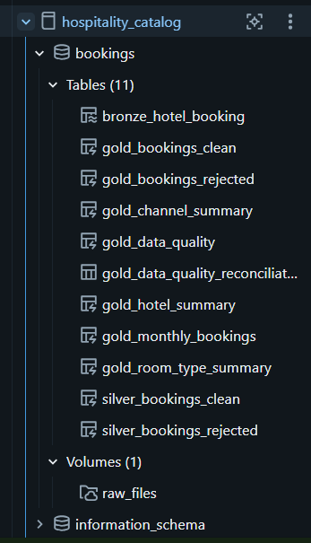
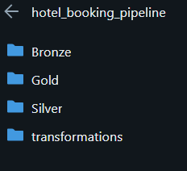
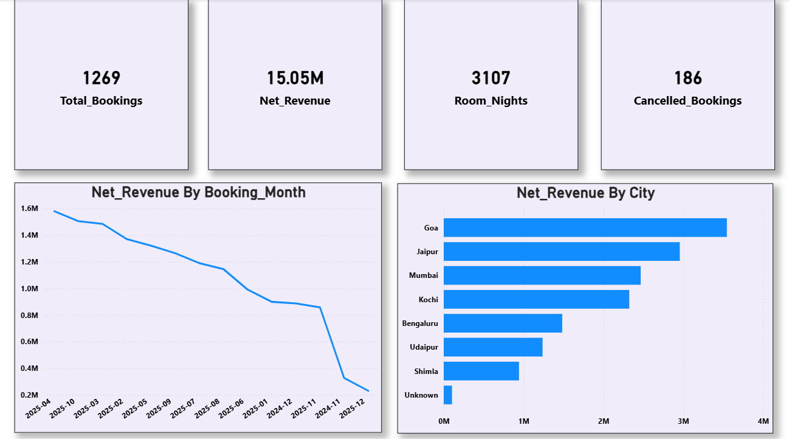
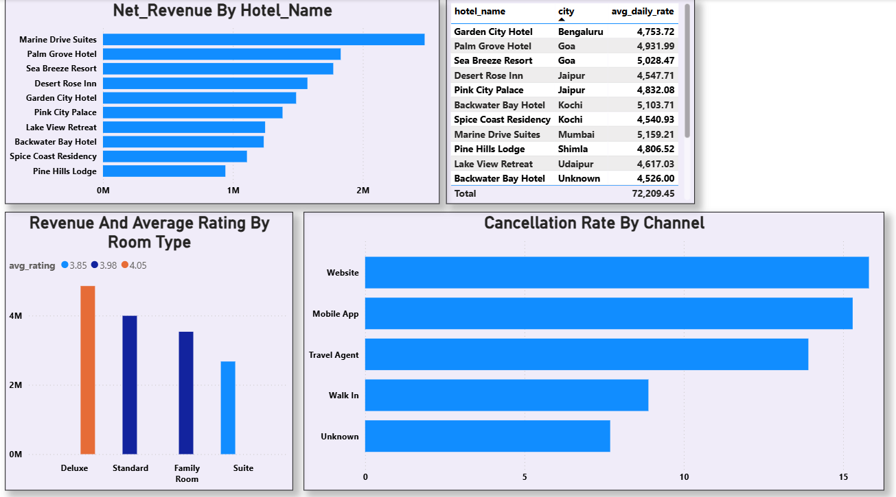
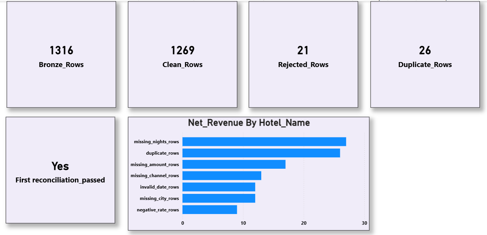

# Hotel Booking Data Engineering Project

## Project Overview
This project implements an end-to-end data engineering pipeline for hotel booking data using **Azure Databricks and Power BI**.

The project follows the Medallion Architecture (Bronze, Silver, and Gold) to ingest raw hotel booking data, clean and validate records, generate business-level summary tables, and build an interactive dashboard.

## Architecture

**CSV File → Bronze → Silver → Gold → Power BI Dashboard**

- **Bronze Layer:** Stores raw data loaded from a CSV file in a Databricks Volume.
- **Silver Layer:** Cleans data, removes duplicate bookings, validates records, and separates rejected records.
- **Gold Layer:** Creates business summary tables for hotel performance, room types, booking channels, monthly bookings, and data quality.

## Technologies Used
- Azure Databricks
- Databricks Lakeflow Declarative Pipelines
- Databricks SQL
- Unity Catalog
- Power BI
- SQL

## Dataset
- Source file: `hotel_bookings_raw.csv`
- Total Bronze records: 1,316

## Medallion Layers

### 1. Bronze Layer
- Ingested raw CSV data from a Databricks Volume.
- Preserved the original source data.
- Added source file and load timestamp metadata.

### 2. Silver Layer
- Removed duplicate booking records.
- Handled missing and blank values.
- Standardized text fields.
- Validated check-in and check-out dates.
- Validated room rates.
- Derived missing stay duration using DATEDIFF.
- Stored rejected records separately with rejection reasons.
- Retained cancelled bookings for analysis.

### 3. Gold Layer
Created the following business tables:

| Gold Table | Purpose |
|---|---|
| gold_monthly_bookings | Monthly booking and revenue analysis |
| gold_hotel_summary | Hotel performance analysis |
| gold_room_type_summary | Room type revenue and rating analysis |
| gold_channel_summary | Booking channel and cancellation analysis |
| gold_data_quality | Data quality metrics and reconciliation |

## Data Quality Reconciliation

The reconciliation condition is:

`Bronze Rows = Clean Rows + Rejected Rows + Duplicate Rows`

The reconciliation check returned **Yes**, confirming that the row counts balance.

## Power BI Dashboard

The dashboard contains three pages:

1. **Overview** – Booking KPIs, revenue trends, and city performance.
2. **Hotel & Booking Analysis** – Hotel revenue, average daily rate, room type performance, and booking channel analysis.
3. **Data Quality** – Bronze, clean, rejected, duplicate counts, reconciliation status, and data quality problem counts.

## Business Outcomes
- Built a repeatable Bronze-to-Gold data pipeline.
- Improved data quality through validation and cleaning.
- Separated rejected records for data quality tracking.
- Enabled hotel revenue, booking, and cancellation analysis.
- Presented business insights through an interactive Power BI dashboard.

## Project Structure

```text
Hotel-Booking-Analytics/
│
├── README.md
│
├── screenshots/
│   ├── pipeline_graph.png
│   ├── gold_tables.png
│   ├── overview_dashboard.png
│   ├── hotel_booking_analysis.png
│   └── data_quality_dashboard.png
│
└── sql/
    ├── bronze/
    ├── silver/
    └── gold/
```

## Conclusion

This project demonstrates how raw hotel booking data can be transformed into clean, reliable, and business-ready information using Databricks Medallion Architecture and Power BI.


## Project Screenshots

### Databricks Catalog


### ETL Pipeline


### Dashboard – Overview


### Hotel & Booking Analysis


### Data Quality Dashboard

